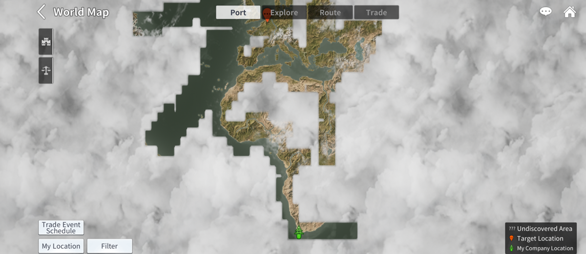
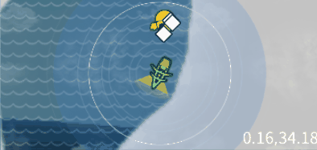
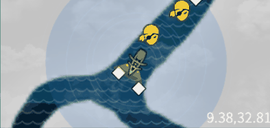

# UWO-Bot — an intelligent(a bit) bot that plays the game *Uncharted Waters Origin*
I have been a huge fan of the Uncharted Waters series games by Koei Tecomo, and have been playing the UnCharted Waters Origin(https://store.steampowered.com/app/1574360/Uncharted_Waters_Origin/ and https://play.google.com/store/apps/details?id=com.linegames.uwogl&hl=en_US) for some time. Also I have been trying to learn AI for some time, but felt I lacked a use case that I am passionate about to go deeper. One day while playing the game, it came to me the using AI to write a bot that plays this game, and also make the bot intellegent would be something really fun. That is how this project got started.

This is a Python bot that plays the mobile game **Uncharted Waters Origin** on a real
Android phone. The bot runs on a Mac, and issues adb commands that are equivalent to the touch and swipe events generated by a human user. It sees only what a player sees — screen captures(through ADB) and drives the game
through ADB touch input. The long-term goal is a self-growing trading company;
today its strongest capability are **autonomous sea & river exploration, and bartering**.

The project started haphazardly predictably, half baked ideas(quite charitable to say that) being thrown around, and hodge podge code being build around them, and maddening issues popping up all around, but as it chugged along, things got better, and I got a better understanding about how to define the work and use AI tools better. The code of this project is entirely written by Claude Code, I did not write a single line, and I do not know Python much either. The pain point has really been how to verify the results, and how to describe the things I wanted to do to Claude, and understand what did Claude build without reading through the code that is in a language I am not familiar at all. I often ran into the cases that when diagnosing problems, the explanation provided by Claude was totally wrong, and Claude would argue with me :D and insist what it said was right. Gradually I devised ways, and let Claude build tools, like the navigation viewer tool shown below in video, that could put all the relevant data into a context, and tell Claude to go through and compare the data sections that are right and wrong, and finally I no longer need to argue with Claude :D.

This has been a really fun experience, and I have been learning a lot of things, most importantly learning how to establish a context so I can verify(also with the help of Claude Code) the code that I myself did not write and do not fully understand. Right now the exploring navigation works well, although still have some challenges(in this game the port name/icons are drawn partly on the water, the handling of that is still not ideal). But the navigation is working reasonably well, the bot has navigated the Nile river, north Africa shoreline down to Capetown. Also the bartering is working for one stage barters, bartering is the most complicated trade in this game, that involves checking the village to know the materials needed for barter, find where the materials are sold, generate a plan, buying materials for barter at multiple ports, then sailing to village to barter, manage load, sometimes needs to dump excesses to make room, then sail to ports where the barter goods can fetch good price. All of these can be done with 2 commands:

1. Generate the task
python run_barter.py --save=svear_birch "barter Birch Tree at Svear Village, and sail to Lisboa"
2. run the task
python run_barter.py --task=svear_birch

The bot uses a combination of vision models(Ominparser, MoonDream, Yolo) and OCR cropping to recognize game controls (sometimes not putting together well, and that is what I am trying to learn more and improve), and also use a self trained U-net(posted as a separate project, this project uses the library generated from it) to recognize the direction of the ship for navigation purpose.

## 🧭 Exploration (the heart of the project)

The bot navigates open sea, winds down rivers, and hugs coastlines **without a
map of its own** — it reads the in-game mini-map each tick, estimates the ship's
heading with a trained Unet, traces the nearest river/coast bank, and steers a
shore-hugging path. That lets it descend the **Nile from Cairo to Lake Victoria
and sail back** with almost no thrashing.

*In-game World Map (Explore view): the revealed terrain — the Nile from the
Mediterranean down to the equatorial lakes, and the North- & West-African
coastline with its river mouths — is what the bot has actually navigated.
Everything still under cloud is undiscovered.*

*Live mini-map (49 consecutive ticks): the bot reaches the Nile's equatorial-lake
terminal (lat ≈ −1.27, the southern turnaround of a Cairo → Lake Victoria → Cairo
round trip) and makes a clean U-turn — the white diamonds trace its path. Full
round trip: 734 ticks / 4 course-flips / zero thrash on the current substrate.*

It also handles **dead ends without a map**: at a Y-junction it probes into the
dead-end tip, reverses out, and commits to the other branch.

*A Y-junction on the Nile (37 consecutive ticks): the ship pushes up into the
dead-end tip, reverses out when it stops making progress, and takes the other
branch — Trémaux-style dead-end handling driven purely by the traced bank.*

*Viewer

The viewer is a debugging tool I developed for the navigation, it shows the voyage tick by tick, with both the frames and the read/calculated data for each frame, like direction, speed etc.

https://github.com/user-attachments/assets/df7c9875-6b91-494a-8bd1-f4acb37c9244

How it works, in layers:
- **L1 heading** — a 220K-param CNN reads ship pose from the mini-map sprite (robust to occlusion).
- **L2 segmentation** — water/land from the mini-map.
- **L3–L4 tactical** — trace the hugging-side bank to the frame-edge exit, offset it inward, and pick reflex/tactical steer points; PID rudder control.
- **L5 mission** — point-to-point and river-explore goals.

Design detail: `docs/loop_navigation_design.md`, `docs/navigation_models_status.md`.

## Running it

Prereqs: an Android phone on ADB (`adb devices`), `scrcpy` for display, Python
deps (`pip install -r requirements.txt`), and model weights
(`python -m vision.omniparser --download`; CNN weights live in `data/models/`).
`vision/models/` and `data/sessions/` are git-ignored (downloaded/produced at runtime).

| Tool | Command | Purpose |
|---|---|---|
| **Live navigation** | `python -m tools.run_ai_nav_live --tactical loop --side port --max-ticks 800` | drive a real voyage on the phone |
| **Evaluate a voyage** | `python -m tools.evaluate_voyage data/sessions/<session>/` | PASS/WARN/FAIL vs the canonical Nile reference |
| **Inspect frames + trace** | `python -m tools.tick_viewer <session>` | step through ticks, jump to issue ticks |
| **Offline sim** | `python -m tools.sim_ai_nav` · `python -m tools.run_sim_voyage` | replay perception/steering without the phone |
| **Regression scenarios** | `python -m pytest tests/tactical_scenarios/` | perceive-from-frames replays of hard cases |
| **Test one half** | `python -m pytest -m "not business"` · `-m "not navigation"` | the suite splits into navigation and business; see `tests/groups.py` |
| **Capture a voyage** | `python -m tools.capture_voyage` · `python -m tools.sail_capture` | record frames + trace for training/eval |
| **Autonomous grow loop** | `python run_task.py tasks/self_grow.yaml` | sail-and-trade loop *(early — see limits)* |
| **Interactive CLI** | `python run.py` | manual commands: goto, sail, trade, explore |
| **Train models** | `python -m tools.train_heading_cnn` · `train_family_classifier` · `train_shoreline_classifier` · `train_minimap_detector` | (re)train the perception CNNs |
| **Calibrate** | `python -m tools.calibrate_steering` · `calibrate_latlon` · `world_map_calibrate` | steering rate, lat/lon affine, world-map anchors |

(There are ~130 scripts under `tools/` — the table lists the day-to-day ones.)

## What it does **not** do well yet

Honest state — the redesign in `docs/refactor_plan_perceive_flow_fsm.md` targets these:

- **Not very intelligent.** most of the actions are still specifically coded, like putting goods into carts, purchasing, enter/exit buildings. The bog can handle some simple dialogs, but complicated ones still require programming specifically. The reasoning part is still very weak, and the next thing I want to do most is to be able to use a flywheel solution(first encounter using ClaudeAPI, then use local LLM like Qwen) to let the bot learn and handle different dialogs, without specifically coding for each of them. 
- **Absolute screen coordinates are brittle.** This has been largely addressed by using Omniparser bboxes, but there are still some stragglers.
- **OmniParser is slow here (~8 s/call, likely CPU)** — the structural-detection
  tier is a bottleneck.

## Docs
- Architecture review: `docs/architecture_review_perceive_flows_2026-08.md`
- Refactor plan: `docs/refactor_plan_perceive_flow_fsm.md`
- Design diagrams (Mermaid): `docs/new_design_diagrams.md`
- Project rules & knowledge map: `CLAUDE.md`
